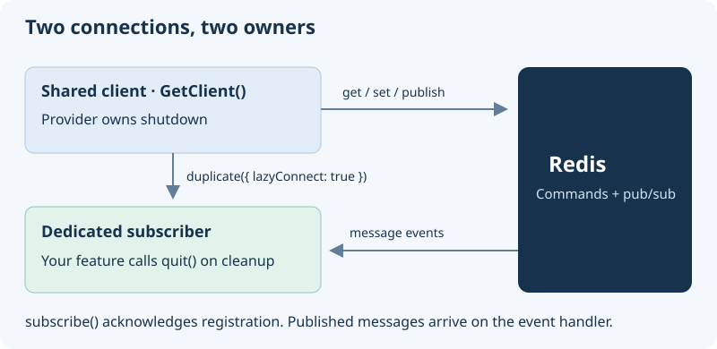

## Overview

Cache values, publish notifications, and run Redis commands through a shared [ioredis](https://github.com/redis/ioredis) client. `GetClient()` is the interface's only application entry point. Command behaviour comes from ioredis and Redis.

## Choose a Redis task

| Task                      | Guide                                           | Watch for                                       |
| ------------------------- | ----------------------------------------------- | ----------------------------------------------- |
| Cache data                | [Key-value operations](#key-value-operations)   | TTLs use seconds. A missing key returns `null`. |
| Receive notifications     | [Pub/sub messaging](#pubsub-messaging)          | Use and close a dedicated subscriber.           |
| Work with lists and sets  | [Additional operations](#additional-operations) | Commands change shared server state.            |
| Execute commands together | [Transactions](#transactions)                   | Atomic execution is not application validation. |

{width="480"}

Configure a Redis implementation and a reachable server first. Installing the interface does not create a connection. Use a disposable database or an isolated key prefix for these examples.

## Getting started

Install the package in your project:

```bash
npm install @antelopejs/interface-redis
```

## `GetClient`

The `GetClient` function returns the shared Redis client. All the Redis operations on this page start from it.

```typescript
import { GetClient } from "@antelopejs/interface-redis";

async function cacheGreeting() {
  const client = await GetClient();
  await client.set("docs:greeting", "Hello from Redis", "EX", 60);
  const greeting = await client.get("docs:greeting");
  console.log(greeting); // "Hello from Redis", or null if the key expired.
}
```

Call `cacheGreeting()` from your initialized application. The `EX` value is a lifetime in seconds, not a timestamp. This example expires its key after one minute.

The function returns a `Promise<Redis>` that the implementing module resolves. Until a module supplies a client, the promise waits. The interface adds no connection timeout. Keep the shared connection open for other consumers and leave its lifecycle to the provider.

The [`@antelopejs/redis`](https://github.com/AntelopeJS/redis) module behaves as follows:

- It supplies the client in its `start` step, as soon as it has created it. It waits for the connection first only when its configuration sets `lazyConnect` or `useMock`. Otherwise the connection may still be opening, and ioredis queues your commands until it is ready, unless the configuration sets `enableOfflineQueue: false`.
- Its `stop` step calls `quit()` on the shared client and resets the promise. A `GetClient()` call after that waits for the next `start`.

## Key-value operations

Redis stores strings. Serialize objects when you write them and parse the returned string when you read it. A missing or expired key returns `null`.

### Store and retrieve values

`JSON.parse` does not check what it returns, so the example keeps the parsed value as `unknown`. Validate its shape before you use its fields.

```typescript
import { GetClient } from "@antelopejs/interface-redis";

async function storeUserData(userId: string, data: object) {
  const client = await GetClient();

  // Store a JSON value
  await client.set(`user:${userId}`, JSON.stringify(data));

  // Retrieve it later
  const raw = await client.get(`user:${userId}`);
  if (raw) {
    const userData: unknown = JSON.parse(raw);
    console.log(userData);
  }
}
```

### Use expiration for temporary data

```typescript
import { GetClient } from "@antelopejs/interface-redis";

async function cacheResponse(key: string, data: string, ttlSeconds: number) {
  const client = await GetClient();

  // Store with an expiration time
  await client.set(key, data, "EX", ttlSeconds);
}

async function getCache(key: string): Promise<string | null> {
  const client = await GetClient();
  return client.get(key);
}
```

### Work with hashes

```typescript
import { GetClient } from "@antelopejs/interface-redis";

async function manageUserProfile(userId: string) {
  const client = await GetClient();

  // Store multiple fields in a hash
  await client.hset(`profile:${userId}`, {
    name: "Alice",
    email: "alice@example.com",
    role: "admin",
  });

  // Retrieve a single field
  const name = await client.hget(`profile:${userId}`, "name");

  // Retrieve all fields
  const profile = await client.hgetall(`profile:${userId}`);
  console.log(profile); // { name: "Alice", email: "alice@example.com", role: "admin" }
}
```

## Pub/sub messaging

Redis pub/sub sends messages between parts of your application as they happen. Use `duplicate()` to create a dedicated subscriber connection. Once a connection subscribes, ioredis rejects every command on it except the subscribe and unsubscribe commands, `ping`, and `quit`.

### Subscribe to a channel

```typescript
import { GetClient } from "@antelopejs/interface-redis";

async function setupNotifications() {
  const client = await GetClient();
  const subscriber = client.duplicate({ lazyConnect: true });

  subscriber.on("message", (channel, message) => {
    console.log(`[${channel}] ${message}`);
  });
  await subscriber.connect();
  await subscriber.subscribe("notifications");
  return subscriber;
}
```

`subscribe()` resolves when Redis acknowledges the subscription. Its optional callback receives the acknowledgement or an error, not published messages.

1. Register the `message` handler before you subscribe.
2. Keep the returned subscriber while the feature is active.
3. Call `await subscriber.quit()` during cleanup. Do not call `quit()` on the shared client.

Pub/sub delivers notifications. It does not store tasks. A subscriber that was disconnected does not receive the messages it missed.

### Publish messages

```typescript
import { GetClient } from "@antelopejs/interface-redis";

async function sendNotification(message: string) {
  const client = await GetClient();
  await client.publish("notifications", message);
}
```

### Pattern-based subscriptions

```typescript
import { GetClient } from "@antelopejs/interface-redis";

async function subscribeToUserEvents() {
  const client = await GetClient();
  const subscriber = client.duplicate({ lazyConnect: true });

  subscriber.on("pmessage", (pattern, channel, message) => {
    console.log(
      `Pattern: ${pattern}, Channel: ${channel}, Message: ${message}`,
    );
  });
  await subscriber.connect();
  // Subscribe to all channels matching the pattern
  await subscriber.psubscribe("user:*:events");
  return subscriber; // Quit this dedicated connection during cleanup.
}
```

## Additional operations

The ioredis client supports every Redis command. The examples below show a few common ones.

### Lists

```typescript
import { GetClient } from "@antelopejs/interface-redis";

async function manageQueue() {
  const client = await GetClient();

  // Push items to a list
  await client.lpush("task-queue", "task-1", "task-2");

  // Pop an item from the list
  const task = await client.rpop("task-queue");
  console.log(task); // "task-1"
}
```

### Sets

```typescript
import { GetClient } from "@antelopejs/interface-redis";

async function trackUniqueVisitors(pageId: string, visitorId: string) {
  const client = await GetClient();

  await client.sadd(`visitors:${pageId}`, visitorId);

  const count = await client.scard(`visitors:${pageId}`);
  console.log(`Unique visitors: ${count}`);
}
```

### Transactions

`multi().exec()` runs the queued commands together. It does not check balances or validate a positive amount. When one command fails, Redis does not roll back the commands that succeeded. The example shows how to group commands. It is not a complete financial transfer. Inspect each result and check your business preconditions separately.

```typescript
import { GetClient } from "@antelopejs/interface-redis";

async function transferCredits(
  fromUser: string,
  toUser: string,
  amount: number,
) {
  const client = await GetClient();

  // Execute multiple commands atomically
  const results = await client
    .multi()
    .decrby(`credits:${fromUser}`, amount)
    .incrby(`credits:${toUser}`, amount)
    .exec();

  if (results === null) {
    throw new Error("Transaction aborted");
  }
  for (const [error] of results) {
    if (error) throw error;
  }
  console.log("Redis commands completed; business validation is separate");
}
```

For the complete list of commands, read the [ioredis documentation](https://github.com/redis/ioredis) and the [Redis command reference](https://redis.io/commands/).
